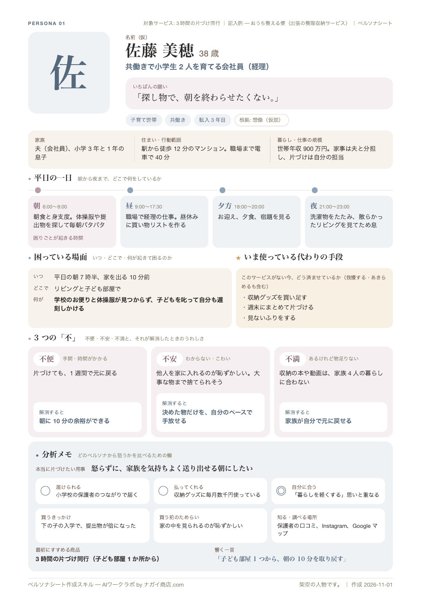
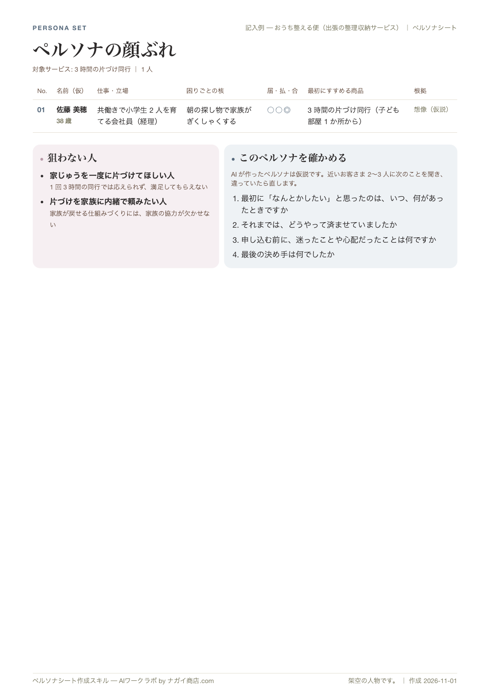
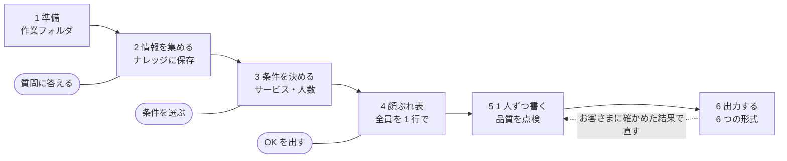
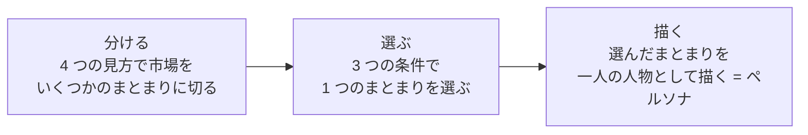
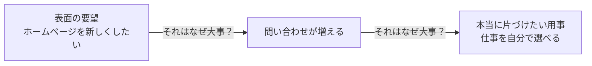
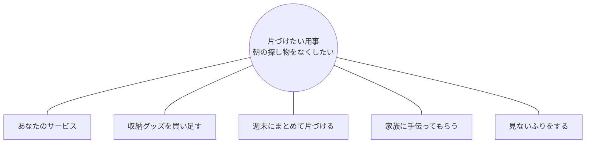
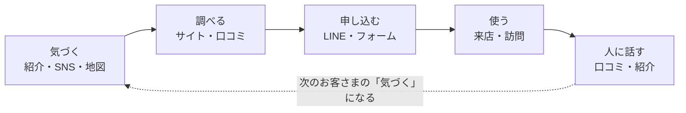
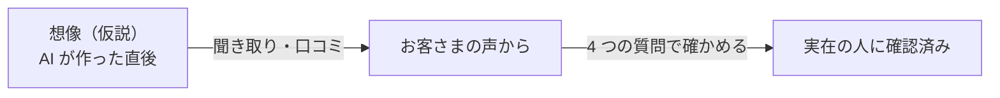

# persona-sheet ペルソナシート作成スキル マニュアル

版 1.0 ｜ 2026-11-03 ｜ ペルソナシート作成スキル ─ AIワークラボ by ナガイ商店.com

自分の AI に入れるだけで、事業の情報を集めて蓄え、お客さま像（ペルソナ）を何人でも作り、A4 のシートにまとめられるスキルです。このマニュアルでは、入れ方から使い方、シートの読み方、もとになっている考え方までを説明します。

動作の正本は `skills/persona-sheet/`（`SKILL.md` と `references/`）です。この文書は人向けの写像で、HTML 版（`docs/persona-sheet/manual.html`）と同じ内容です。配布用の zip は `skills/persona-sheet/scripts/build_distribution.py` が組み立てます（[配布物の作り方](#配布物の作り方)）。

## 目次

1. [このスキルでできること](#1-このスキルでできること)
2. [全体の流れ](#2-全体の流れ)
3. [どんな考え方で作っているか](#3-どんな考え方で作っているか)
4. [準備するもの](#4-準備するもの)
5. [スキルを入れる](#5-スキルを入れる)
6. [はじめてのペルソナづくり](#6-はじめてのペルソナづくり)
7. [できあがるもの](#7-できあがるもの)
8. [シートの読み方](#8-シートの読み方)
9. [一覧ページの読み方](#9-一覧ページの読み方)
10. [ペルソナを確かめて育てる](#10-ペルソナを確かめて育てる)
11. [続けて使う](#11-続けて使う)
12. [上手に使うコツ](#12-上手に使うコツ)
13. [困ったとき](#13-困ったとき)
14. [大切なこと](#14-大切なこと)
15. [配布の条件](#15-配布の条件)
16. [ことばの説明](#16-ことばの説明)

---

## 1. このスキルでできること

ペルソナとは、サービスを届けたい相手を、実在しそうな一人の人物として描いたものです。「30〜50 代の女性」のような平均像ではなく、名前・年齢・一日の過ごし方・困っている場面まで具体的に描くことで、値段・届け方・伝える言葉を決めやすくなります。

このスキルを AI に入れておくと、「ペルソナを作りたい」と話しかけるだけで、次のことを AI が手順どおりに進めます。

- **事業の情報を集めて蓄える。** ホームページ・手元の資料・AI からの質問への答えから集め、「ナレッジ」として保存します。次からは集め直さずに使えます
- **ペルソナを何人でも作る。** 対象のサービスと人数を選べます。今のお客さまに近い人と、これから狙いたい新しい層を混ぜて作ります
- **A4 のシートにまとめる。** 1 人 1 ページのシートと、全員を比べる一覧ページを作ります。出力は Markdown・HTML・PDF・アーティファクト・JSON・YAML から選べます
- **販促まで使える中身にする。** 困りごと（不便・不安・不満）、買うきっかけ、申し込む前のためらい、どこで知り調べるか、響く一言まで書きます
- **写真を付ける。** 画像を作れる AI なら、ペルソナの顔写真も付けられます。Claude Code でも、GPT Image 2 や Nano Banana などの画像生成を使えるようにしておけば、写真を生成して配置できます。画像を作れないときは、名前の頭文字のアイコンになります

| 1 人 1 ページのシート（記入例） | 先頭に付く一覧ページ（記入例） |
|---|---|
|  |  |

## 2. 全体の流れ

AI が 6 つの段階で進めます。あなたの出番は、質問に答える・条件を選ぶ・顔ぶれ表に OK を出す、の 3 か所です。



2〜4 の段階では、AI があなたに質問します。出力した後に、お客さまに確かめた結果を伝えると、5 の段階に戻ってペルソナを直します。

## 3. どんな考え方で作っているか

このスキルは、マーケティングで広く使われている考え方を、小さな事業でも使える形にまとめ直して、AI に手順として渡しています。シートのどの欄も、次のどれかの考え方につながっています（シートの欄は [8 章](#8-シートの読み方)で説明します）。考え方を知っておくと、AI が作ったペルソナを読み解き、直すときの手がかりになります。

### 「みんな」ではなく「一人」を描く

誰にでも向けたサービスは、誰にも選ばれにくくなります。相手が一人に決まると、その人に合う値段・届け方・言葉を選べるようになります。マーケティングでは、市場を切り分け（Segmentation）、狙う相手を選び（Targeting）、相手の頭の中での覚えられ方を決める（Positioning）流れを、頭文字を取って STP と呼びます。ペルソナは、2 つめの「選ぶ」の結果を一人の人物として描いたものです。



市場を分け、狙うまとまりを選び、その中の一人を具体的に描く。この 3 つめが、このスキルの作るペルソナです。

### 市場を切り分ける 4 つの見方

| 見方 | 見るもの | シートの欄 |
|---|---|---|
| **属性** | 年齢・性別・家族・職業・収入 | 見出し・基本情報 |
| **場所** | 住まい・職場・ふだん動く範囲 | 住まい・行動範囲 |
| **気持ち** | 価値観・こだわり・暮らし方 | いちばんの願い・本当に片づけたい用事 |
| **行動** | 使う頻度・買うきっかけ・求めるもの | 平日の一日・買うきっかけ |

1 つの見方だけでは輪郭がぼやけます。さらに「いつ」「どんなとき」に困るのかまで絞ると、顔が浮かぶようになります。たとえば「飲食店の店主」ではなく、「仕込みと営業の合間の 15 分で、予約の電話を折り返している店主」です。シートに「平日の一日」と「困っている場面」があるのは、このためです。

### 狙う相手を選ぶ 3 つの条件

マーケティングでは、市場の大きさ・伸び・競合の強さ・届けやすさなどで狙う相手を選びます。小さな事業では、次の 3 つに絞ると判断しやすくなります。3 つが重なるところにいる人から狙います。シートの分析メモでは、それぞれに ◎ ○ △ × と理由を付けます。

| 条件 | 見ること |
|---|---|
| **届けられる** | 自分の告知や紹介の輪の中にいるか。直接会える、知り合いを通じて話が伝わる、などの道があるか |
| **払ってくれる** | その困りごとのために、今すでに何かを払っているか（お金・時間・手間）。払っていない困りごとは、話題にはなっても申し込みにつながりにくい |
| **自分に合う** | 自分の目指すこと・得意なこと・無理なく続けられる働き方と重なるか |

反対に「この人には売らない」と決めた人物像を、ネガティブペルソナ（狙わない人）と呼びます。一覧ページの「狙わない人」がこれです。

### 困りごとは 3 つの「不」で見る

日本のマーケティングや商品企画でよく使われる分け方です。3 つは別々の困りごとにします。同じ話の言い換えにすると、サービスの打ち手が 1 つしか出てきません。

| 不 | 中身 | サービスが応える方向の例 |
|---|---|---|
| **不便** | 面倒、時間を取られる、手が回らない | 手間を引き受ける、早く済むようにする |
| **不安** | よく分からない、失敗がこわい、人に聞けない | 分かる言葉で説明する、そばで支える、結果を約束する |
| **不満** | 今のものでは足りない、自分に合っていない | 中身を良くする、その人に合わせる |

シートでは、それぞれの「不」に「解消すると」を添えます。サービスの機能ではなく、その人が変わった後の姿を書きます。価値とは「何をするか」ではなく「相手の何が変わるか」だからです。

### その先のうれしさをたどる

お客さまの要望をそのまま受け取らず、「それが大事なのはなぜか」「その先にどうなるとよいか」をたどります。インタビューで使われるラダリングという聞き方です。2〜3 段たどった先が、その人が本当に片づけたい用事です。



表面の要望（ホームページ）ではなく、奥の用事（仕事を選べる）をシートの「本当に片づけたい用事」に書きます。

### 人は用事を片づけるために商品を「雇う」

クレイトン・クリステンセンの「ジョブ理論」の考え方です。人は商品そのものが欲しいのではなく、片づけたい用事（ジョブ）のために商品を雇います。すると、競合は同業だけではなくなります。同じ用事を片づけられるものは、自分でやる、家族に頼む、無料の情報で済ませる、あきらめる、まで含めてすべて競合です。



同じ用事のために「雇われる」候補は、すべて比べる相手です。シートの「いま使っている代わりの手段」に、あなたのサービス以外の候補を書きます。

### 動き出す力と、止める力

ボブ・モエスタらが整理した、人が今のやり方から乗り換えるときに働く 4 つの力（Four Forces of Progress）です。動き出す力が止める力を上回ったとき、人は申し込みます。困りごとが大きくても、ためらいと慣れが強ければ動きません。

| 向き | 力 | シートの欄 |
|---|---|---|
| 動き出す力 | 今への不満 | 3 つの「不」 |
| 動き出す力 | 新しいものへの期待 | 解消すると・本当に片づけたい用事 |
| 止める力 | 新しいものへの心配 | 買う前のためらい |
| 止める力 | 今のやり方への慣れ | いま使っている代わりの手段 |

動き出す力の 2 つが止める力の 2 つを上回ると、人は申し込みます。

困りごとはずっと前からあっても、実際に申し込むのは「きっかけの出来事」が起きたときです（子どもの入学、繁忙期の失敗、スタッフの退職、家族の入院など）。シートの「買うきっかけ」にはこの出来事を書きます。ためらいを減らす手は、提供の仕方の工夫になります（お試し、少額の入口、実例を見せる、家族も一緒に聞ける）。

### どこで知り、どう調べ、誰に話すか

お客さまがサービスに出会い、申し込み、人に話すまでの道すじを、カスタマージャーニーと呼びます。インターネットが当たり前になってから、「気になったら調べる」「使ったら人に話す・投稿する」が加わりました（電通が提唱した AISAS がこの流れを表しています）。



最初の 2 段階（気づく・調べる）が、シートの「知る・調べる場所」にあたります。地域の小さな事業ほど、「人に話す」から「気づく」へ戻る循環が効きます。

信頼している人からの一言は、広告を何度も見るより強く背中を押します。シートの「知る・調べる場所」には、その人が「誰の話なら信じるか」も含めて書きます。

### お客さまが会社のとき

取引先が会社なら、買うかどうかを決める人、実際に使う人、意見を言う人が別々のことがあります。ペルソナは主に「困りごとを感じている人」で描き、決める人が別にいるなら、その人の心配（費用の説明ができるか、社内が反対しないか）を「買う前のためらい」に書きます。

### ペルソナは仮説 ─ 確かめて育てる

- ペルソナには根拠の強さに段階があります。思い込みだけで作ったもの、少人数のお客さまの話から作ったもの、大規模な調査から作ったもの、です（Nielsen Norman Group による分類）。AI が作るペルソナは、最初の段階にあたります
- AI が作る人物像は、性別や年代についてありがちな描写に寄りやすいことが研究で示されています（Cheng, Durmus, Jurafsky「Marked Personas」2023 年）。このスキルが顔ぶれの偏りを点検し、根拠を表示するのはこのためです
- 実在する一人のお客さまを深く知ることが、いちばん確かな出発点になります（西口一希さんの「N1 分析」の考え方）。ナレッジに具体的なお客さまの話があれば、AI はそれを核にペルソナを作ります

### ペルソナを伝える言葉につなぐ

伝える言葉は、サービスの中身ではなく、相手の何が変わるかで書きます。シートの「響く一言」は、そのペルソナに最初に見せるチラシや投稿の見出しのつもりで書いています。相手がどこまで気づいているかで、効く言葉も変わります。

| 相手の状態 | 効く伝え方 |
|---|---|
| **困りごとに気づいていない** | 困っている場面を描いて、「それ、困っていませんか」と気づいてもらう |
| **気づいて、解決の方法を探している** | 解決した後の姿を見せる |
| **方法を比べている** | 他との違いと、ためらいへの答え（お試し・実例・保証）を見せる |

考え方の詳しい説明は、スキルの中の `references/customer-thinking.md` にあります。AI はペルソナを書く前に、このファイルを読みます。

## 4. 準備するもの

- 次のどれかの AI。有料プランをおすすめします
- PDF を自動で作るなら、パソコンに Google Chrome か Microsoft Edge（Windows には Edge が最初から入っています）
- あれば、事業のホームページの URL と、会社案内・チラシ・アンケート・お客さまの声のメモなどの資料

| AI | 入れ方 | 写真 | PDF |
|---|---|---|---|
| **Claude のアプリ（チャット・Cowork）** | zip ファイルをアップロード | 頭文字のアイコン | HTML を開いて保存 |
| **Claude Code** | フォルダを置く | 頭文字のアイコン（画像生成を足せば写真も） | 自動で作成 |
| **ChatGPT の Codex（アプリ・CLI・エディタ）** | フォルダを置く | 生成できる | 設定によって自動 |
| **Google Antigravity（アプリ・CLI）** | フォルダを置く | AI による | 設定によって自動 |
| **ChatGPT のデスクトップアプリ（スキルが使えるプラン）** | zip ファイルをアップロード | 生成できる | HTML を開いて保存 |

2026 年 11 月時点の情報です。各社の画面や対応プランは変わることがあります。

## 5. スキルを入れる

配布ファイルの中にある `persona-sheet` フォルダ（または `persona-sheet.zip`）を使います。フォルダの名前は変えないでください。

### Claude のアプリ（claude.ai・デスクトップ・Cowork）

1. 設定（Settings）→ 機能（Capabilities）で、「コード実行とファイル作成（Code execution and file creation）」をオンにします
2. カスタマイズ（Customize）→ スキル（Skills）→「＋」→ スキルをアップロード（Upload a skill）を選び、`persona-sheet.zip` を選びます
3. スキルの一覧で persona-sheet がオンになっていることを確かめます

### Claude Code

1. Mac は Finder で ⌘＋Shift＋G を押し、`~/.claude/skills` と入力して開きます。Windows はエクスプローラーのアドレス欄に `%USERPROFILE%\.claude\skills` と入力します（`skills` フォルダがなければ作ります）
2. そこへ `persona-sheet` フォルダをまるごと入れます
3. Claude Code を起動し直します。Claude Code に「ダウンロードした persona-sheet フォルダを、~/.claude/skills に入れて」と頼んでもかまいません

### ChatGPT の Codex（アプリ・CLI・エディタ）

1. Mac は `~/.agents/skills`、Windows は `%USERPROFILE%\.agents\skills` を開きます（なければ作ります）
2. そこへ `persona-sheet` フォルダをまるごと入れ、Codex を起動し直します

### Google Antigravity（アプリ・CLI）

1. Mac は `~/.gemini/config/skills`、Windows は `%USERPROFILE%\.gemini\config\skills` を開きます（なければ作ります）
2. そこへ `persona-sheet` フォルダをまるごと入れ、新しい会話を始めます。CLI では `/skills reload` でも読み込めます

### ChatGPT のデスクトップアプリ（スキルが使えるプランのみ）

1. スキル（Skills）→ 作成（Create）→ パソコンからアップロード（Upload from computer）を選び、`persona-sheet.zip` を選びます

### 入ったかを確かめる

新しい会話で「使えるスキルを教えて」と聞き、persona-sheet が出てくれば入っています。Claude Code・Codex・Antigravity の CLI では `/skills` でも一覧を見られます。

> Mac で `.claude` のような「.」で始まるフォルダが見えないときは、Finder で ⌘＋Shift＋.（ピリオド）を押すと表示されます。

## 6. はじめてのペルソナづくり

### 作業フォルダを用意する

1. ペルソナづくり用のフォルダを 1 つ作ります。例: 書類フォルダの中に「ペルソナ」
2. AI でそのフォルダを開きます。Cowork はフォルダを選び、Claude Code・Codex・Antigravity はそのフォルダで起動します。チャットだけの AI は、そのままで使えます
3. AI がフォルダの中に `ペルソナづくり` を作ります。資料があれば、その中の `資料` フォルダに入れます

> **開いたフォルダの中で作業します**
> 多くの AI は安全のため、開いているフォルダの外ではコマンドの実行やファイルの移動ができません。ダウンロードフォルダなど別の場所で作りたいときは、そのフォルダを AI で開き直してから頼んでください。

### 会話の流れ

おおよそ次のように進みます。例は、出張の整理収納サービス「おうち整える便」（架空）の場合です。AI によって言い回しや質問の出し方（選択肢のボタンか、番号の一覧か）は変わります。

**あなた**
ペルソナを作りたい。サイトは https://example.com です。

**AI**
ペルソナづくりを始めます。まず事業の情報を集めます。使う方法を選んでください（いくつでも選べます）。

1. Web サイト（おすすめ）
2. 手元の資料（`ペルソナづくり/資料` に入れたファイル）
3. 聞き取り（私が質問します）

**あなた**
1 と 2。資料にチラシを入れました。

**AI**
サイトの 7 ページとチラシを読み、ナレッジにまとめました。事業の概要とサービス一覧は次のとおりです。間違いや抜けはありますか。

（事業の概要とサービス一覧が表示されます）

もう 2 つだけ教えてください。分からなければ飛ばしてかまいません。

1. お客さまが申し込む前に、よく迷うこと・心配することは何ですか
2. 最後の決め手になったと言われたことは何ですか

**あなた**
「家の中を見られるのが恥ずかしい」とよく言われます。決め手は「1 か所からでも頼める」ことでした。

**AI**
ありがとうございます。作る条件を決めます。

1. 対象サービス: 3 時間の片づけ同行 / 定期の片づけサポート / 事業全体
2. 人数: 3 人（おすすめ）/ 5 人 / 10 人
3. 顔ぶれ: 今のお客さまに近い人と新しい層を半々（おすすめ）/ 今のお客さま中心 / 新しい層中心
4. 出力形式（いくつでも）: HTML と PDF（おすすめ）/ Markdown / JSON と YAML

**あなた**
3 時間の片づけ同行、3 人、半々、HTML と PDF で。

**AI**
詳しく書く前に、顔ぶれを確かめてください。

| No. | 名前・年齢 | 仕事・立場 | 困りごとの核 | 根拠 |
|---|---|---|---|---|
| 01 | 佐藤 美穂（38） | 共働きの会社員 | 朝の探し物で家族がぎくしゃくする | お客さまの声から |
| 02 | 加藤 修（45） | 単身赴任から戻った会社員 | 2 世帯分の物があふれる | 想像（仮説） |
| 03 | 木村 幸子（67） | 夫を亡くした一人暮らし | 夫の遺品に手をつけられない | 想像（仮説） |

狙わない人: 家じゅうを一度に片づけてほしい人（1 回 3 時間では応えられないため）

直したい点はありますか。

**あなた**
02 は 30 代の夫婦にしてください。

**AI**
02 を「第一子が生まれる 30 代の夫婦」に変えました。これで書き進めてよいですか。

**あなた**
OK

**AI**
3 人分を書き、シートを作りました。

`ペルソナづくり/シート/ペルソナシート_2026-11-03.html`
`ペルソナづくり/シート/ペルソナシート_2026-11-03.pdf`

このペルソナは仮説です。近いお客さま 2〜3 人に、一覧ページの 4 つの質問を聞いてみてください。結果を教えていただければ直します。

3 人なら、会話を始めてから 10〜20 分ほどが目安です（集める情報の量と AI によって変わります）。

## 7. できあがるもの

作業フォルダの中は、次のようになります。`ナレッジ` と `ペルソナ` は文章のファイルなので、自分で開いて直せます。

```text
ペルソナづくり/
├── 資料/        自分で入れる資料（会社案内・チラシ・アンケート・メモ）
├── ナレッジ/    集めた事業の情報
│   ├── 事業の概要.md
│   ├── サービス一覧.md
│   ├── お客さまの情報.md
│   ├── 競合と代わりの手段.md
│   └── 出典.md          どこから集めたか
├── ペルソナ/    一覧.md と、1 人 1 ファイル（01_佐藤美穂.md …）
└── シート/      出力したファイル（写真を付けたときは 写真/ も）
```

### 出力形式の選び方

どの形式も、全員分を 1 つのファイルにまとめます。ファイル名は `ペルソナシート_日付` で、同じ名前があれば `_2` が付きます（上書きはしません）。

| 形式 | 向いている使い方 |
|---|---|
| **HTML** | ブラウザで見る・印刷する。PDF のもとになります |
| **PDF** | 配る・印刷する・保存する |
| **Markdown** | 文章として読む・直す。ほかの AI に渡す |
| **JSON・YAML** | 表計算やほかのツールにデータとして取り込む |
| **アーティファクト** | Claude のアプリで、会話の横にそのまま表示する |

## 8. シートの読み方

1 人 1 ページのシートは、上から次の順に並んでいます。色にも意味があり、青は日常、紫は困りごと、金色は代わりの手段です。


| 欄 | 書いてあること | 使いどころ |
|---|---|---|
| **見出し** | 名前（仮）・年齢・仕事や立場・いちばんの願い・タグ・根拠 | どんな人かを一言でつかむ。根拠で、確かさの段階が分かる |
| **基本情報** | 家族・住まいと行動範囲・暮らしや仕事の規模 | どこで会えるか、いくらなら払えるかを考える材料 |
| **平日の一日** | 朝・昼・夕方・夜の過ごし方。紫の時間帯に困りごとが起きる | 連絡や広告が届く時間、サービスを使える時間を考える |
| **困っている場面** | いつ・どこで・何が起きて困るのか | チラシやサイトで描く「あるある」の場面になる |
| **いま使っている代わりの手段** | このサービスがない今、どう済ませているか | 本当の比べる相手。値段と伝え方の基準になる |
| **3 つの「不」** | 不便・不安・不満と、それぞれが解消したときの姿 | サービスの中身と、約束する変化を決める |
| **本当に片づけたい用事** | 困りごとの奥にある、その人の目的 | 何屋として覚えてもらうかの手がかり |
| **届けられる・払ってくれる・自分に合う** | ◎ ○ △ × と理由 | どのペルソナから狙うかを比べる |
| **買うきっかけ・買う前のためらい** | 動き出す出来事と、止める心配 | 声をかける時期と、ためらいを消す工夫（お試し・実例） |
| **知る・調べる場所** | その人が情報に出会う場所、確かめる場所 | 告知の場所を選ぶ |
| **最初にすすめる商品・響く一言** | 入口になる商品と、最初に見せる見出し | チラシや投稿の見出し、最初の提案にそのまま使う |

## 9. 一覧ページの読み方

シートの先頭に付く一覧ページは、全員を見比べて「誰から狙うか」を決めるためのページです。12 人を超えると、一覧ページが 2 枚以上になります。

- **比較表**: 全員の仕事・困りごとの核・3 つの条件（届・払・合）・最初にすすめる商品・根拠が 1 行ずつ並びます。3 つの条件がすべて ○ 以上の人から狙うのが基本です
- **狙わない人**: 「この人には売らない」と決めた人物像と理由です。伝える言葉がぶれず、合わない依頼で時間を失うことが減ります
- **このペルソナを確かめる**: 実在のお客さまに聞く 4 つの質問です。次の章で使い方を説明します


## 10. ペルソナを確かめて育てる

AI が作るペルソナは、もっともらしく見えても仮説です。実在のお客さまで確かめるほど、根拠の段階が上がり、使える道具になります。



根拠の 3 段階です。シートの見出しと一覧ページに、いまどの段階かが表示されます。

1. ペルソナに近いお客さまを 2〜3 人思い浮かべます
2. 会ったときや電話のついでに、一覧ページの 4 つの質問を聞きます
   - 最初に「なんとかしたい」と思ったのは、いつ、何があったときですか
   - それまでは、どうやって済ませていましたか
   - 申し込む前に、迷ったことや心配だったことは何ですか
   - 最後の決め手は何でしたか
3. 答えをそのまま AI に伝えます。AI がペルソナを直し、合っていた人の根拠を「実在の人に確認済み」に上げて、シートを作り直します

**あなた**
お客さまに聞いてみた結果で 01 を直して。きっかけは「下の子の入学」ではなく「義母の同居」でした。迷ったのは料金で、決め手は友人の紹介でした。

**AI**
01 の買うきっかけ・ためらい・知る場所を直し、根拠を「実在の人に確認済み」にしました。シートを作り直しています。

## 11. 続けて使う

2 回目からは、ナレッジとペルソナが残っているので、続きから頼めます。AI でいつもの作業フォルダを開いて話しかけます。

| 頼み方の例 | AI がすること |
|---|---|
| **「ペルソナをあと 2 人追加して。今度は 60 代も入れて」** | 今の顔ぶれと重ならない 2 人を考え、顔ぶれ表で確かめてから書きます |
| **「新しく始める〇〇のペルソナを 3 人作って」** | サービス一覧にない場合は内容を聞き、ナレッジに足してから作ります |
| **「サイトを更新したので、情報を集め直して」** | ナレッジに追記し、影響を受けるペルソナの作り直しを提案します |
| **「お客さまに聞いた結果で 02 を直して」** | 02 を直し、根拠を上げて、シートを出し直します |
| **「シートを PDF でも作って」** | ペルソナはそのままで、シートだけを作り直します |
| **「03 の文章を自分で直したので、シートを作り直して」** | `ペルソナ/03_….md` を読み直して、シートを出し直します |

## 12. 上手に使うコツ

- **お客さまの言葉を渡す。** アンケート、口コミ、問い合わせメール、聞き取りのメモがあれば、`資料` に入れます。サイトの情報だけだと、全員が「想像（仮説）」になります
- **迷いと決め手の 2 問には答える。** ペルソナの質を一番左右するのが、この 2 つです。覚えている範囲の一言で十分です
- **顔ぶれ表で遠慮なく直す。** 詳しく書いた後より、表の段階で直す方がずっと早く済みます。「全員似ている」「この業種も入れて」と伝えます
- **5 人ずつ作る。** 一度にたくさん作るより、5 人ずつ作って見直す方が、似た人が並びにくくなります
- **「狙わない人」も見る。** 違和感があれば直してもらいます。断る基準がはっきりします
- **作ったら確かめる。** 4 つの質問を 2〜3 人に聞くだけで、ペルソナの確かさが大きく上がります

## 13. 困ったとき

| こんなとき | こうしてください |
|---|---|
| **スキルが使われない** | 「persona-sheet スキルを使ってペルソナを作りたい」と名前を出して頼みます。それでも使われなければ、[5 章](#5-スキルを入れる)の「入ったかを確かめる」で確かめ、入れ直して AI を起動し直します |
| **別のフォルダで作ってほしい** | そのフォルダを AI で開き直してから頼みます。開いていないフォルダには作りません |
| **PDF ができない** | HTML ファイルをブラウザで開き、上の「印刷・PDF 保存」ボタンを押します。送信先を「PDF に保存」にし、用紙 A4・余白なし・背景のグラフィックをオン・ヘッダーとフッターをオフにして保存します |
| **シートの文字が小さい・紫の枠が出る** | 文章が長く、1 ページに収まりにくいしるしです。「02 の文章を短くして作り直して」と頼みます |
| **写真が付かない** | Claude はそのままでは画像を作れないため、名前の頭文字のアイコンになります。Claude Code なら、GPT Image 2（ChatGPT の Codex 経由）や Nano Banana（Google の Gemini）で画像を作るスキルや MCP を入れておくと、写真を生成して配置できます。画像を作れる AI（ChatGPT の Codex など）で使う方法もあります |
| **同じような人ばかりになる** | 顔ぶれ表の段階で「年代・業種をもっとばらけさせて」「新しい層を増やして」と伝えます |
| **途中で会話が切れた** | 同じ作業フォルダを開いて「ペルソナづくりの続きをして」と頼みます。ナレッジとペルソナのファイルから続きを始めます |
| **ペルソナを自分で直したい** | `ペルソナ` フォルダの Markdown を直し、「シートだけ作り直して」と頼みます |
| **チャットだけの AI で、ファイルが残らない** | AI が最後に、ナレッジとペルソナをまとめた 1 つのファイルを渡します。保存しておき、次回の最初に渡してください |

## 14. 大切なこと

> **AI が作るペルソナは「仮説」です**
> もっともらしく見えても、実在のお客さまで確かめるまでは仮説として扱ってください。[10 章](#10-ペルソナを確かめて育てる)の 4 つの質問で確かめるほど、使える道具になります。

> **お客さまの個人情報は入れないでください**
> 入力した内容は、使っている AI サービスに送られます。資料やメモにお客さまの名前・連絡先が含まれる場合は、消してから入れてください。スキルも、ナレッジやペルソナに個人を特定できる情報を書かないように作っています。データの扱いは、各 AI サービスの利用規約と設定をご確認ください。

> **ペルソナの名前は仮の名前です**
> 実在の人とは関係ありません。シートの下にも「架空の人物です」と入ります。

## 15. 配布の条件

このスキルは **クリエイティブ・コモンズ 表示 4.0 国際（CC BY 4.0）** で提供しています。商用でも自由に使い、直し、ほかの人に配れます。配るときは、次の 3 つを守ってください。

1. 作者の表示「ペルソナシート作成スキル ─ AIワークラボ by ナガイ商店.com（https://ai.nagai-shouten.com/）」を残す
2. CC BY 4.0 であることを示す（スキルの中の `LICENSE.md` を残す）
3. 直して配るときは、直したことを書く

作者を消して、自分が作ったものとして配ることはできません。このスキルで作ったナレッジ・ペルソナ・シートは作った人のもので、自由に使えます。シートの下のクレジットも、「シートの下のクレジットを消して」と頼めば消せます。

ライセンスの概要: <https://creativecommons.org/licenses/by/4.0/deed.ja>

## 16. ことばの説明

| 用語 | 意味 |
|---|---|
| **ペルソナ** | サービスを届けたい相手を、実在しそうな一人の人物として描いたもの |
| **スキル** | AI に渡しておく手順書と道具のセット。話しかけると、AI がその手順で作業する |
| **ナレッジ** | 集めた事業の情報。`ナレッジ` フォルダに保存され、次回からも使われる |
| **顔ぶれ表** | ペルソナを詳しく書く前に、全員を 1 行ずつ並べて確かめる表 |
| **根拠** | そのペルソナが何に基づいているか。想像（仮説）・お客さまの声から・実在の人に確認済みの 3 段階 |
| **困りごとの核** | その人の困りごとを一言で言ったもの。一覧ページに載る |
| **3 つの「不」** | 困りごとの分け方。不便・不安・不満 |
| **本当に片づけたい用事** | 困りごとの奥にある、その人の目的。ジョブ理論でいうジョブ |
| **代わりの手段** | このサービスがない今、その人がどう済ませているか。同業以外も含めた本当の比べる相手 |
| **狙わない人** | 「この人には売らない」と決めた人物像（ネガティブペルソナ） |
| **アーティファクト** | Claude のアプリで、会話の横にページとして表示される出力 |
| **Markdown・JSON・YAML** | 文章やデータを書くためのファイル形式。Markdown は人が読みやすく、JSON と YAML はほかのツールに取り込みやすい |

---

## 配布物の作り方

人向けの配布物（マニュアル PDF・スキルのフォルダ・Claude アプリ用 zip）は、リポジトリの外に組み立てます。リポジトリ内には生成物を残しません。

```bash
python3 -I skills/persona-sheet/scripts/build_distribution.py
```

- 出力先は `~/Downloads/persona-sheet-dist/` です（第 1 引数で変更できます）。`ペルソナシート作成スキル_v1.0.zip` ができ、中身はマニュアル PDF・`persona-sheet/`・`persona-sheet.zip`（直下に `persona-sheet/`）の 3 つです
- マニュアル PDF は `docs/persona-sheet/manual.html` から、ヘッドレスの Google Chrome（または Microsoft Edge）で A4 に出力します。事前に Chrome か Edge が入っている必要があります
- 配る zip には `scripts/` を含めません（配布先の利用者には不要なため）
- 同じ出力先が既にあるときは、中身を確かめてから退避してください。上書きはしません
- `docs/persona-sheet/manual.html` を直したら、見た目の確認と PDF のページ数（20 ページ前後）の確認をしてから配布します
